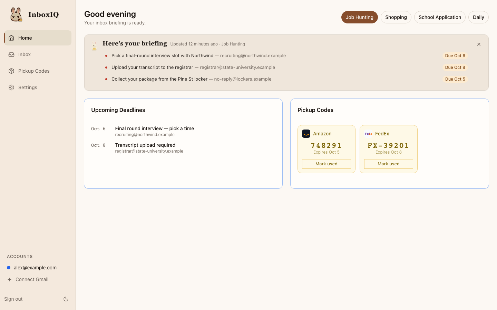
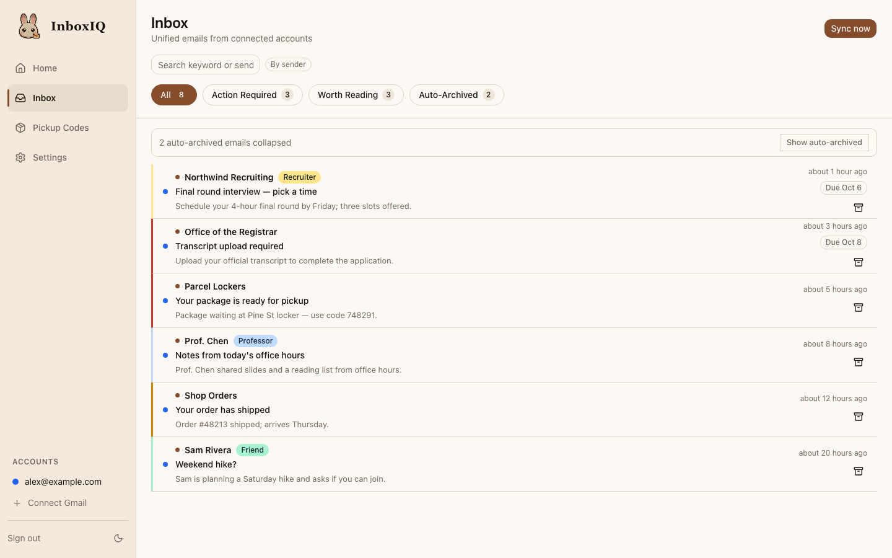
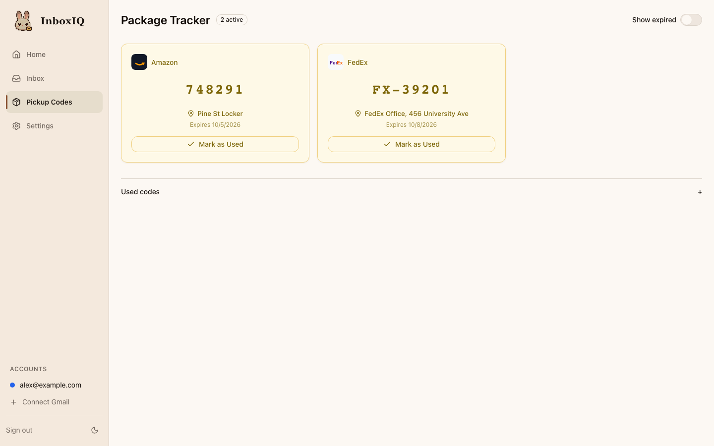
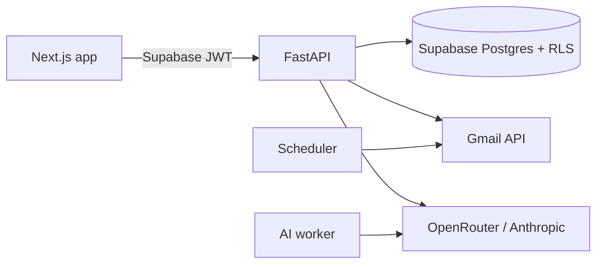

# InboxIQ

**AI triage for a busy inbox.** InboxIQ connects to Gmail and sorts every email
into *Action required*, *Worth reading* or *Auto-archive* based on what you're
focused on right now. It also pulls out deadlines and package pickup codes, so
nothing urgent gets buried.

[](https://github.com/Joh221105/InboxIQ/actions/workflows/ci.yml)
[](LICENSE)



## Features

- **Context-aware triage:** switch between Job Hunting, Shopping, School
  Application and Daily modes, and your recent mail is re-triaged for that focus.
- **Daily briefing:** a short summary of what needs attention today, with due
  dates.
- **Deadline extraction:** due dates are pulled from email bodies and listed on
  the dashboard.
- **Pickup-code tracker:** locker and pickup codes are detected automatically,
  with a QR code and *Mark as used*, which also archives the email in Gmail.
- **Contact tags:** tag a sender or a whole `@domain` (professor, recruiter,
  friend, custom). Past emails are tagged retroactively, and tagged mail is
  never auto-archived.
- **Fast inbox:** full-text search, search by sender and keyboard navigation.

| Inbox | Pickup codes |
| --- | --- |
|  |  |

## How it works



- A scheduler syncs connected Gmail accounts every few minutes.
- A background worker triages new mail with a context-specific prompt, using
  OpenRouter with an Anthropic fallback. Every response is validated against a
  schema before it is stored.
- Switching context re-triages recent mail in a background job.
- OAuth tokens and the database service key never leave the API. Every query
  is scoped to the verified user, with Postgres row-level security as a
  second line of defense.

See [docs/architecture.md](docs/architecture.md) for the full design.

## Tech stack

| Area | Technology |
| --- | --- |
| Frontend | Next.js 14 (App Router), TypeScript, Tailwind CSS, shadcn/ui, TanStack Query |
| Backend | FastAPI, Pydantic v2, httpx, APScheduler |
| AI | OpenRouter (Mistral 7B, free tier) with Anthropic Claude Haiku fallback |
| Data & auth | Supabase Postgres and Auth, row-level security |
| Testing | pytest, respx, Vitest, Testing Library, Playwright |
| Hosting | Vercel (frontend), Railway (backend) |

## Getting started

### Prerequisites

- Python 3.11 and Node 20
- A [Supabase](https://supabase.com) project
- A Google Cloud OAuth client with the Gmail API enabled and the redirect URI
  `http://localhost:8000/auth/gmail/callback`
- An [OpenRouter](https://openrouter.ai) or [Anthropic](https://console.anthropic.com) API key

### 1. Database

Apply the migrations in order (001–022). Either paste the output of
`make migrations` into the Supabase SQL editor, or pipe it to `psql`.

Then, in Supabase under **Authentication → URL configuration**:
- set the site URL to `http://localhost:3000`
- add `http://localhost:3000/auth/callback` as a redirect URL

### 2. Configure

```bash
cp backend/.env.example backend/.env
cp frontend/.env.example frontend/.env.local
```

| Variable | Where | Required | Purpose |
| --- | --- | --- | --- |
| `SUPABASE_URL` | backend | yes | Supabase project URL |
| `SUPABASE_SERVICE_ROLE_KEY` | backend | yes | Server-side database access (never sent to the browser) |
| `SUPABASE_JWT_SECRET` | backend | legacy only | Verifies HS256 tokens; leave blank for JWT signing keys |
| `GMAIL_CLIENT_ID`, `GMAIL_CLIENT_SECRET` | backend | yes | Google OAuth client |
| `GMAIL_REDIRECT_URI` | backend | yes | Must match the URI registered in Google Cloud |
| `OAUTH_STATE_SECRET` | backend | yes | Signs the OAuth `state` parameter (32+ random characters) |
| `OPENROUTER_API_KEY` / `ANTHROPIC_API_KEY` | backend | at least one | LLM providers (OpenRouter is tried first) |
| `FRONTEND_URL` | backend | yes | Where OAuth redirects the user back to |
| `ALLOWED_ORIGINS` | backend | no | Comma-separated CORS allowlist (defaults to `FRONTEND_URL`) |
| `DEMO_MODE` | backend | no | `true` seeds a sample inbox when a Gmail account connects |
| `ENVIRONMENT`, `LOG_LEVEL`, `SENTRY_DSN`, `GIT_SHA` | backend | no | Operations and error reporting |
| `NEXT_PUBLIC_SUPABASE_URL`, `NEXT_PUBLIC_SUPABASE_ANON_KEY` | frontend | yes | Supabase Auth in the browser |
| `NEXT_PUBLIC_API_URL` | frontend | yes | Backend base URL |

### 3. Run

```bash
make install   # backend virtualenv + frontend dependencies
make dev       # API on :8000 (docs at /docs), app on :3000
```

Sign up, open **Settings → Connect Gmail**, and new mail appears with triage
results within a minute or two.

## Testing

```bash
make lint typecheck test               # ruff, mypy, pytest, ESLint, tsc, Vitest
cd frontend && npm run test:e2e        # Playwright against a production build
cd frontend && npm run screenshots     # regenerate the images above
```

Prompt-quality checks call a real LLM and are opt-in:
`cd backend && RUN_AI_QUALITY_TESTS=1 .venv/bin/pytest tests/ai_quality`.

## Project structure

```
backend/
  app/
    core/        config, auth, error envelope, background tasks
    routers/     HTTP endpoints
    services/    Gmail sync, AI triage, retriage, contact tagging, digest
    db/          typed Supabase queries
    models/      Pydantic models
    prompts/     static LLM prompts per context mode
    tasks/       AI worker and scheduler
    demo/        sample inbox for DEMO_MODE
  supabase/      SQL migrations and RLS tests
frontend/
  app/           Next.js routes
  components/    UI components
  lib/           API client, React Query hooks, Supabase clients
  tests/         Vitest unit tests and Playwright e2e
docs/            architecture and screenshots
```

## Deployment

- **Vercel:** set the root directory to `frontend/` and add the three
  `NEXT_PUBLIC_*` variables.
- **Railway:** set the root directory to `backend/`. The start command comes
  from the `Procfile`. Add the backend variables, with `ENVIRONMENT=production`.
- **Production URLs:** point `GMAIL_REDIRECT_URI` (and the Google Cloud
  redirect URI), `FRONTEND_URL`, and the Supabase Auth URLs at your production
  domains.
- **Database:** apply new migrations *before* deploying the API that needs
  them (migrations are backward compatible with the previous API), then run
  `backend/supabase/tests/test_rls.sql` against the production database to
  confirm row-level security.

## Acknowledgments

Built by John Huang. Product concept by Ting Li. InboxIQ started as a project in
the University of Washington Global Innovation Exchange (GIX) program.

## License

[MIT](LICENSE)
