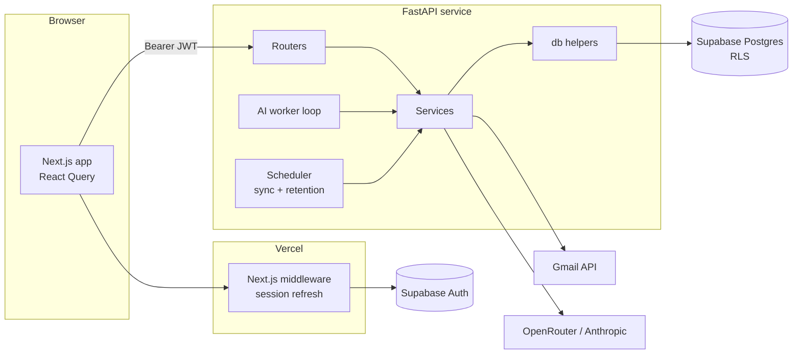

# Architecture

InboxIQ is a Next.js frontend and a FastAPI backend backed by Supabase
(Postgres and Auth). The backend owns everything that touches Gmail tokens or
LLM providers; the browser only ever holds a Supabase session and talks to the
API with that session's JWT.

## Components



The backend is layered, and each layer only calls the one below it:

| Layer | Path | Responsibility |
| --- | --- | --- |
| Routers | `app/routers/` | HTTP shape: parse input, call one service or db helper, return a model |
| Services | `app/services/` | Business logic: Gmail sync, AI triage, retriage, contact tagging, digest |
| Data | `app/db/` | Typed PostgREST queries; every query is scoped to the verified user |
| Models | `app/models/` | Pydantic request/response and domain models |
| Core | `app/core/` | Config, auth, error envelope, background tasks, clock, logging |
| Tasks | `app/tasks/` | Long-running loops started with the app (AI worker, scheduler) |

## Email sync

1. A user connects Gmail through OAuth (`/auth/gmail/start` → Google →
   `/auth/gmail/callback`). The `state` parameter is a signed JWT with a
   10-minute expiry, a nonce and a same-origin `return_to`.
2. Tokens are stored server-side on `connected_accounts`; an initial sync is
   started in the background.
3. The scheduler runs every 5 minutes and syncs accounts not synced in the
   last 14 minutes. Users can also trigger `POST /accounts/{id}/sync`.
4. The first sync fetches the 50 newest messages; later syncs use Gmail's
   `after:` query from the last successful sync. Messages are fetched with
   per-account concurrency of 5 (10 accounts at a time), parsed to plain text,
   and upserted through the `upsert_email_record` RPC, which also attaches a
   matching contact tag.
5. An expired or revoked refresh token marks the account disconnected; the UI
   prompts the user to reconnect.
6. A daily job (03:00) deletes emails older than each user's
   chosen retention period.

## AI triage pipeline

The AI worker polls every 30 seconds for unprocessed emails, in batches of 10,
and stops a batch once it has spent $0.50.

- **Classification:** each context mode (Job Hunting, Shopping, School
  Application, Daily) has its own static system prompt in `app/prompts/`.
  Email content is only ever placed in the user turn.
- **Extraction:** when the classifier flags them, deadline, action-item and
  pickup-code extraction run concurrently. A regex prefilter also catches
  pickup codes the classifier misses.
- **Providers:** OpenRouter (free tier) first, with Anthropic Claude Haiku as
  the fallback (`app/services/ai_client.py`). Transient provider errors are
  retried with backoff.
- **Validation:** every response is parsed as JSON and validated against a
  Pydantic model. Malformed JSON gets one more attempt. Emails that fail three
  times show "(AI unavailable)" and are no longer retried.
- **Cost tracking:** every call is recorded in `ai_usage`.
- Mail from a tagged contact is never auto-archived.

## Context switch and retriage

`PATCH /users/me/context` changes the user's mode and re-triages their 100
most recent unread emails in the background. It is rate-limited to once a
minute per user. The client polls `GET /jobs/{id}` until the job finishes.

## Data model

| Table | Purpose |
| --- | --- |
| `users` | Profile, current context mode, notification and retention preferences |
| `connected_accounts` | Gmail account, OAuth tokens, sync state, display color |
| `emails` | Synced messages plus AI output (category, summary, deadline, pickup code) |
| `contact_tags` | Sender or `@domain` tags (professor, friend, recruiter, custom) |
| `daily_digests` | One cached briefing per user per day |
| `ai_usage` | Per-call token counts and cost |

Migrations live in `backend/supabase/migrations/` (001–022) and are applied in
order. `emails.triage_rank` (022) is a generated column that lets the inbox
order by priority and recency in a single keyset-paginated query.

## Security model

- **Authentication:** the API verifies the Supabase JWT on every request:
  JWKS for ES256/RS256 projects, the shared secret for legacy HS256.
- **Data access:** the service-role key is used only in `app/db/supabase.py`,
  and every query filters by the verified user's id. Row-level security is
  enabled on every table as a second line of defense
  (`backend/supabase/tests/test_rls.sql` checks it).
- **OAuth tokens** never leave the backend; the browser sees only the account
  address and connection status.
- **Email HTML** is sanitized server-side (scripts, styles and event handlers
  removed) and rendered in an `<iframe sandbox="">`.
- **CORS** uses an exact origin allowlist.

## Error handling

Services and the data layer raise domain errors from `app/core/errors.py`
(`NotFoundError`, `ConflictError`, `BadRequestError`, `RateLimitedError`). One
handler turns them into:

```json
{ "detail": { "code": "duplicate_contact", "message": "This sender is already tagged." } }
```

Rate-limited responses also carry `retry_after_seconds` and a `Retry-After`
header. Request validation errors keep FastAPI's standard 422 shape. The
frontend's `apiFetch` parses both into an `ApiError`.

## Known limitations

- OAuth tokens are stored as JSONB, protected by RLS and the service boundary
  but not encrypted at the application level.
- Job progress and rate limits are held in memory, which assumes a single API
  instance; a restart loses in-flight job status.
- Only Gmail is supported.
- The frontend is on Next.js 14, which has open security advisories that need
  a major-version upgrade.
